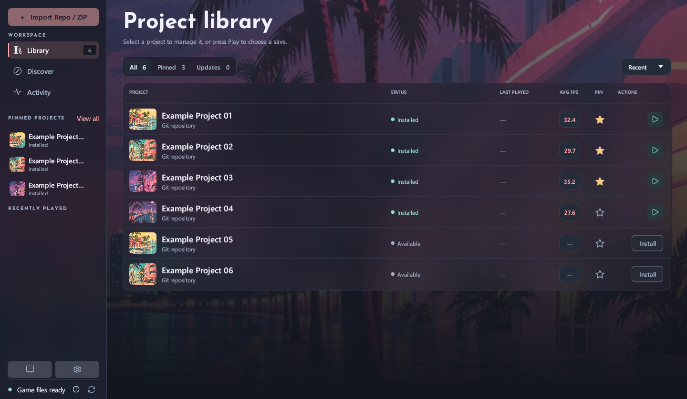
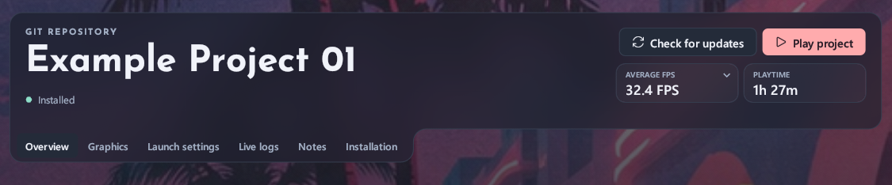

# PalmVI Launcher

PalmVI is a Windows launcher for VIctory builds, prebuilt ZIPs and standalone Rust projects. Keep builds side by side, start them from the same save, and compare how they run on your PC.

**[Download PalmVI.exe for Windows x64](https://github.com/TheGameOnAddict/PalmVI_Launcher/releases/latest/download/PalmVI.exe)** · [Release notes](https://github.com/TheGameOnAddict/PalmVI_Launcher/releases)

Already using Mandyhub? Select **Check for update** and then **Update and restart**. PalmVI uses your existing library, settings and saves. The v0.3.0 release also includes the identical executable under the previous filename for older updaters.

## Your library

Install or update projects directly from the Library. Pin frequently used builds, browse recent projects in the sidebar, or open Discover to find PortWatch projects. **Import Repo / ZIP** adds a Git repository or prebuilt Windows build.



Each profile brings together its launch controls, graphics, saves, notes, live logs and installation details. The frosted header shows average FPS and total playtime. For screenshots, turn on **Sharing mode** to replace project names and hide private details.



## Compare performance

- **Playtime** accumulates while the launched process runs. Shader warm-up takes place before the timer starts.
- **Avg FPS** uses the renderer readings a compatible build writes to its log. Click the Library column heading to sort in either direction. A dash means there are no eligible readings.
- **Exclude exactly 60 FPS** is enabled by default. Click the FPS card or open the Library sort menu to change it. The filter applies to every reported 60.0, including gameplay. Filtered history starts with builds of PalmVI that record filtered readings.
- **Reset FPS average** in a profile starts a fresh comparison for that project and preserves its playtime.
- **Activity** holds previous session logs. Open **Live logs** on a profile to follow the current run, copy its output or export the launch report.

## Appearance and Discord

Choose a wallpaper, import a background image, adjust the workspace colors and change the frosted glass in Settings. The CPU and GPU bars at the top open the system comparison.

Discord Rich Presence is on by default. Supported game launches show **Newer Retail Game** with elapsed time while Discord desktop is running. You can turn this off in Settings. Idle presence requires a separately configured launcher application ID.

## Graphics settings

Set your defaults in **Settings → Graphics**. Open a VIctory project’s **Graphics** tab to override the global defaults.

| Preset | Console profile | Render scale |
| --- | --- | --- |
| **Fast** | Series S | 50% |
| **Balanced** | Series S | 75% |
| **Best quality** | Series X | 100% |

Open **Other graphics settings** to choose a **Series X** or **Series S** profile, enable the **8 GB graphics card fix** or **Brighter shadows**, or switch to **Borderless fullscreen**. Supported builds also let you set the output resolution to **720p**, **936p**, **1080p**, **1440p**, or **2160p (4K)**. Select **Game default** to let the build choose the output resolution.

The project shows **Using global** or **Overrides global** so you can see which settings are active. Select **Use global settings** to clear a project's graphics override.

## Save picker

For VIctory builds, **Play** opens the save picker. Continue a save, start fresh, copy an earlier
save or a save from another build, or launch from a favorite checkpoint. To
keep a reusable checkpoint, select a save, click **Add to favorites**, and name
it. Each checkpoint launch uses a copy.

Use **Import save ZIP** in the picker to add a downloaded save to Favorites.
Select an existing save or checkpoint and choose **Export selected save** to
make a shareable ZIP. Imports copy the save data into a new checkpoint.
Choose **Delete selected save** to move a save out of the picker. PalmVI
keeps the files under `deleted-saves` in its install folder for recovery.


## Launcher features

- **Your system** opens from the sidebar or the hardware bars. CPU and GPU meters compare theoretical compute performance with the corresponding PS5 component. The white mark on each bar indicates 1×. The comparison works offline and uses the bundled model ratings in [hardware-comparison.json](data/hardware-comparison.json).
- **Projects from PortWatch:** the list of public projects, live, with their reported frame rate, the graphics cards they were made for, and whether PortWatch has verified them.
- **Custom Git links:** add a Rust project with a Git clone URL from GitHub, GitLab, Codeberg, Gitea, or a self-hosted server.
- **Rust workspaces:** PalmVI builds the workspace and starts its program from **Play**. Library-only workspaces show **Built**.
- **ZIP builds:** choose **Import Repo/Zip → Import build ZIP…** to import a prebuilt Windows executable and its bundled files. PalmVI uses its normal game launch flow for `victory.exe`.
- **Activity log:** use **Export log…** to share the launch report and full captured output. The report includes the executable, arguments, console settings, effective `VICTORY_*` switches, and shader and pipeline warm-up results.
- **Scarlett launch presets** follow the installed script's defaults while preserving profile edits. Warm-up and Play use the same working directory, switches, cache and save folder. With warm-up enabled, Activity shows whether the shader pass ran, reused the cache, or encountered a problem. Pipeline warm-up has its own result in the exported log.
- **Rescan scripts** in **Launch settings → Saved presets** to choose from the installed project's supported PowerShell launch scripts. After a project update, PalmVI offers a fresh selection and remembers it for that revision. Re-selecting the same script preserves your profile edits.
- **Project updates** pulse yellow on the project's **Check for updates** button. Selecting a project with an available update or finding one through a manual check opens **Overview**, where you can choose **Update now**.
- **Parallel installs and updates** let you start another project's install, update, or ZIP import while one is running. The bottom bar counts active installs and updates. Select a project to see its progress and copy or export its Activity log.
- **Install once, play many times:** a project is downloaded and built on your PC once and stays installed.
- **Updates:** installed projects are checked for new versions at start and every 15 minutes; an update can be installed now or later.
- **Install folder:** choose where projects are downloaded and built (a big drive is best); installed projects can be moved there.
- **Uninstall:** removes a project's download, build and shader cache (saves stay).
- **Game files check:** choose your game files folder to enable Play on VIctory builds.
- **Project profiles** keep launch arguments, environment switches, and private notes for each build.
- **Launch presets** are in **Launch Settings**. Paste raw arguments and switches into the project fields, then use **Save as preset…** to save both under a name. In **Saved presets**, apply or delete an existing preset, or use **Import file…** or **Paste preset text…** to add one someone shared.
- **PowerShell presets** read literal `VICTORY_*` defaults from scripts such as `play-scarlett.ps1`. PalmVI preselects a detected custom script in **Launch Settings** and offers it the first time you press **Play**. Confirm your choice once and PalmVI uses those profile settings on later launches. Applying the script exposes any recognized Ray tracing, Probe rays, and Hooks toggles. Use **Import file…** to select another script.
- **Build tracking:** see when you last ran a build and spot installs and updates you have yet to try.
- **Sharing mode** replaces repo names and links with examples and hides private details such as paths, notes, and logs.
- **Compatibility:** build forks with a nested Cargo workspace and use shader warm-up on Scarlett builds that provide the `shaders` command.

No game files are included or downloaded. You need your own copy of the game.

## Requirements

- Windows 10 or 11, 64-bit
- To build projects: Git, Rust and the C++ build tools. PalmVI finds them where their installers put them, and **Install missing tools for me** installs what is missing with winget (Windows asks for permission).

## Build

```powershell
cargo build --release
```

The launcher is `target\release\mandyhub.exe`.

Before publishing a Windows release, scan the final executable on the release PC. If you sign the executable, scan it after signing.

```powershell
.\scripts\Test-ReleaseBinary.ps1 -Path .\target\release\mandyhub.exe
```

The check prints the Defender definition version and the SHA-256 to match against the uploaded GitHub asset. If Defender flags a build, hold that release and submit the exact file for [Microsoft developer review](https://www.microsoft.com/en-us/wdsi/filesubmission).

## Fonts

The display type is Josefin Sans and Big Shoulders Display, built into the exe from `fonts/` under the SIL Open Font License (license texts in `fonts/`). Reading text and icons use Windows' own Segoe UI and Segoe Fluent Icons.

## Credits

PalmVI builds on the original Mandyhub launcher by **Zettrox**. Project list from [PortWatch](https://portwatch-vi.xyz). The projects are their authors' work, built on VIctory by Marvisak and its contributors.

- [ellion369](https://github.com/ellion369) designed and implemented the launcher redesign.
- [TheGameOnAddict](https://github.com/TheGameOnAddict) maintains PalmVI and contributed its workspace, save tools, per-project settings, playtime and FPS tracking, compatibility fixes and updater.
