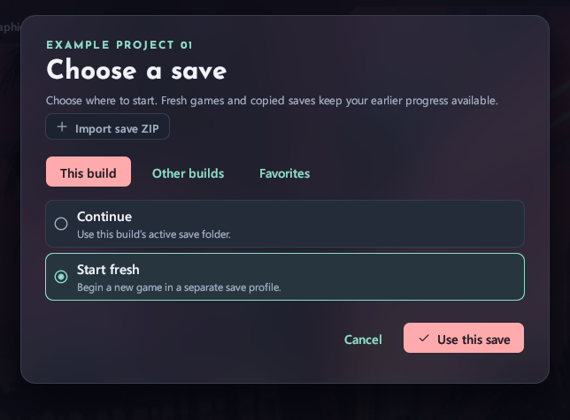

# Mandyhub

A Windows community launcher for VIctory builds, prebuilt ZIPs, and standalone Rust projects.

[Download Mandyhub for Windows](https://github.com/TheGameOnAddict/mandyhub-sinkfinger/releases/latest).
Mandyhub checks for launcher updates on startup. You can also select **Check for update** in the bottom bar or at the bottom of Settings. **Update and restart** downloads the release, verifies its SHA-256 checksum, and reopens Mandyhub.

## Graphics settings

Set your defaults in **Settings → Graphics**. Each VIctory project has its own **Project graphics** controls beside **Play**.

| Preset | Console profile | Render scale |
| --- | --- | --- |
| **Fast** | Series S | 50% |
| **Balanced** | Series S | 75% |
| **Best quality** | Series X | 100% |

Open **Other graphics settings** to choose a **Series X** or **Series S** profile, enable the **8 GB graphics card fix** or **Brighter shadows**, or switch to **Borderless fullscreen**. Supported builds also let you set the output resolution to **720p**, **936p**, **1080p**, **1440p**, or **2160p (4K)**. Select **Game default** to let the build choose the output resolution.

The project shows **Using global** or **Overrides global** so you can see which settings are active. Select **Use global settings** to clear a project's graphics override.

## Save picker

For VIctory builds, **Play** opens the save picker. Continue a save, start fresh, copy an earlier
save or a save from another build, or launch from a favorite checkpoint. To
keep a reusable checkpoint, select a save, click **Add to favorites**, and name
it. Each checkpoint launch uses a copy.

Use **Import save ZIP** in the picker to add a downloaded save to Favorites.
Select an existing save or checkpoint and choose **Export selected save** to
make a shareable ZIP. Imports copy the save data into a new checkpoint.
Choose **Delete selected save** to move a save out of the picker. Mandyhub
keeps the files under `deleted-saves` in its install folder for recovery.

## Launcher features

- **Your system** appears beside the project details in wide windows. CPU and GPU meters compare theoretical compute performance with the corresponding PS5 component. The white mark on each bar indicates 1×. The comparison works offline and uses the bundled model ratings in [hardware-comparison.json](data/hardware-comparison.json).
- **Projects from PortWatch:** the list of public projects, live, with their reported frame rate, the graphics cards they were made for, and whether PortWatch has verified them.
- **Custom Git links:** add a Rust project with a Git clone URL from GitHub, GitLab, Codeberg, Gitea, or a self-hosted server.
- **Rust workspaces:** Mandyhub builds the workspace and starts its program from **Play**. Library-only workspaces show **Built**.
- **ZIP builds:** choose **Import Repo/Zip → Import build ZIP…** to import a prebuilt Windows executable and its bundled files. Mandyhub uses its normal game launch flow for `victory.exe`.
- **Activity log:** use **Export log…** to share the launch report and full captured output. The report includes the executable, arguments, console settings, effective `VICTORY_*` switches, and shader and pipeline warm-up results.
- **Scarlett launch presets** follow the installed script's defaults while preserving profile edits. Warm-up and Play use the same working directory, switches, cache and save folder. With warm-up enabled, Activity shows whether the shader pass ran, reused the cache, or encountered a problem. Pipeline warm-up has its own result in the exported log.
- **Rescan scripts** in **Launch settings → Saved presets** to choose from the installed project's supported PowerShell launch scripts. After a project update, Mandyhub offers a fresh selection and remembers it for that revision. Re-selecting the same script preserves your profile edits.
- **Project updates** pulse yellow on the project's **Check for updates** button. Selecting a project with an available update or finding one through a manual check opens **Overview**, where you can choose **Update now**.
- **Parallel installs and updates** let you start another project's install, update, or ZIP import while one is running. The bottom bar counts active installs and updates. Select a project to see its progress and copy or export its Activity log.
- **Install once, play many times:** a project is downloaded and built on your PC once and stays installed.
- **Updates:** installed projects are checked for new versions at start and every 15 minutes; an update can be installed now or later.
- **Install folder:** choose where projects are downloaded and built (a big drive is best); installed projects can be moved there.
- **Uninstall:** removes a project's download, build and shader cache (saves stay).
- **Game files check:** choose your game files folder to enable Play on VIctory builds.
- **Project profiles** keep launch arguments, environment switches, and private notes for each build.
- **Launch presets** are in **Launch Settings**. Paste raw arguments and switches into the project fields, then use **Save as preset…** to save both under a name. In **Saved presets**, apply or delete an existing preset, or use **Import file…** or **Paste preset text…** to add one someone shared.
- **PowerShell presets** read literal `VICTORY_*` defaults from scripts such as `play-scarlett.ps1`. Mandyhub preselects a detected custom script in **Launch Settings** and offers it the first time you press **Play**. Confirm your choice once and Mandyhub uses those profile settings on later launches. Applying the script exposes any recognized Ray tracing, Probe rays, and Hooks toggles. Use **Import file…** to select another script.
- **Build tracking:** see when you last ran a build and spot installs and updates you have yet to try.
- **Screenshot mode** replaces repo names and links with examples and hides private details such as paths, notes, and logs.
- **Compatibility:** build forks with a nested Cargo workspace and use shader warm-up on Scarlett builds that provide the `shaders` command.

No game files are included or downloaded. You need your own copy of the game.

## Screenshots

These screenshots use example projects, saves, and performance figures.




## Requirements

- Windows 10 or 11, 64-bit
- To build projects: Git, Rust and the C++ build tools. Mandyhub finds them where their installers put them, and **Install missing tools for me** installs what is missing with winget (Windows asks for permission).

## Build

```powershell
cargo build --release
```

The launcher is `target\release\mandyhub.exe`.

## Backgrounds

Put your own `.jpg` or `.png` pictures in `%LOCALAPPDATA%\Mandyhub\backgrounds`. They slowly move and fade into each other in a banner across the top of each project's page. Without pictures, the page has no banner.

## Fonts

The display type is Josefin Sans and Big Shoulders Display, built into the exe from `fonts/` under the SIL Open Font License (license texts in `fonts/`). Reading text and icons use Windows' own Segoe UI and Segoe Fluent Icons.

## Credits

Mandyhub by **Zettrox**. Project list from [PortWatch](https://portwatch-vi.xyz). The projects are their authors' work, built on VIctory by Marvisak and its contributors.

- [ellion369](https://github.com/ellion369) designed and implemented the launcher redesign.
- [TheGameOnAddict](https://github.com/TheGameOnAddict) contributed the save picker and named checkpoints, project settings and notes, build tracking, compatibility fixes, and release updater.
