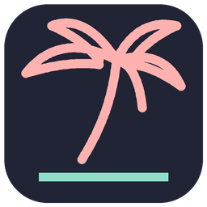

#  PalmVI Launcher

PalmVI is a Windows launcher for VIctory builds, prebuilt ZIPs and standalone Rust projects. Keep builds side by side, start them from the same save, and compare how they run on your PC.

**[Download PalmVI.exe for Windows x64](https://github.com/TheGameOnAddict/PalmVI_Launcher/releases/latest/download/PalmVI.exe)** · [Release notes](https://github.com/TheGameOnAddict/PalmVI_Launcher/releases)

Already using Mandyhub? Select **Check for update** and then **Update and restart**. PalmVI uses your existing library, settings and saves. The v0.3.0 release also includes the identical executable under the previous filename for older updaters.

## Your library

Install or update projects directly from the Library. Pin frequently used builds, browse recent projects in the sidebar, or open Discover to find PortWatch projects. **Import Repo / ZIP** adds a Git repository or prebuilt Windows build.


Each profile brings together its launch controls, graphics, saves, notes, live logs and installation details. The frosted header shows average FPS and total playtime. For screenshots, turn on **Sharing mode** to replace project names and hide private details.


## Compare performance

- **Playtime** accumulates while the launched process runs. Shader warm-up takes place before the timer starts.
- **Avg FPS** uses the renderer readings a compatible build writes to its log. Click the Library column heading to sort in either direction. A dash means there are no eligible readings.
- **Exclude exactly 60 FPS** is enabled by default. Click the FPS card or open the Library sort menu to change it. The filter applies to every reported 60.0, including gameplay. Filtered history starts with builds of PalmVI that record filtered readings.
- **Reset FPS average** in a profile starts a fresh comparison for that project and preserves its playtime.
- **Activity** holds previous session logs. Open **Live logs** on a profile to follow the current run, copy its output or export the launch report.

## Appearance and Discord

Choose a wallpaper, import a background image, adjust the workspace colors and change the frosted glass in Settings. The CPU and GPU bars at the top open the system comparison.

Discord Rich Presence is on by default for **Newer Retail Game**. During a supported launch, Discord displays the registered game activity and elapsed playtime. You can turn this off in Settings. Idle presence requires a separately configured launcher application ID.

## Graphics settings

Set your defaults in **Settings → Graphics**. Open a VIctory project’s **Graphics** tab to override the global defaults.

| Preset | Console profile | Render scale |
| --- | --- | --- |
| **Fast** | Series S | 50% |
| **Balanced** | Series S | 75% |
| **Best quality** | Series X | 100% |

Open **Other graphics settings** to choose a **Series X** or **Series S** profile, enable the **8 GB graphics card fix** or **Brighter shadows**, or switch to **Borderless fullscreen**. Supported builds also let you set the output resolution to **720p**, **936p**, **1080p**, **1440p**, or **2160p (4K)**. Select **Game default** to let the build choose the output resolution.

The project shows **Using global** or **Overrides global** so you can see which settings are active. Select **Use global settings** to clear a project's graphics override.

## NVIDIA RT source builds

Import the NVIDIA RT Git repository and choose **Install**. PalmVI builds its release profile and passes the configured game path to the fork’s native launcher. The initial project graphics use Series X, 1440p and borderless fullscreen. Choose **Installation → Install NVIDIA DLSS files** to download optional Streamline components from NVIDIA. On Windows 10, installation also provisions the Microsoft D3D12 Agility runtime beside the build.

After install or update, PalmVI detects the project’s launch settings and opens a setup dialog. Choose a console profile and either **Recommended optimizations** or **Baseline**. Tuning works with either console. You can also choose resolution, DLSS, frame generation, frame limit and display options. **Save choices** applies them to the project. **Decide later** keeps the existing choices.

Reopen the same controls in **Launch settings**. **Save profile as preset** makes a named copy of your configuration, including graphics, tuning, arguments and switches, for later use or export. Advanced arguments remain available. Use **F1** for the fork’s saved settings and **F3** for its performance panel. Saved F1 choices can override the starting console, resolution, DLSS and frame rate. PalmVI keeps using the selected save and the project’s shader cache.

## Save picker

For VIctory builds, **Play** opens the save picker. Continue a save, start fresh, copy an earlier
save or a save from another build, or launch from a favorite checkpoint. To
keep a reusable checkpoint, select a save, click **Add to favorites**, and name
it. Each checkpoint launch uses a copy.

Use **Import save ZIP** in the picker to add a downloaded save to Favorites.
Select an existing save or checkpoint and choose **Export selected save** to
make a shareable ZIP. Imports copy the save data into a new checkpoint.
Choose **Delete selected save** to move a save out of the picker. PalmVI
keeps the files under `deleted-saves` in its install folder for recovery.


## Launcher features

- **Your system** opens from the sidebar or the hardware bars. CPU and GPU meters compare theoretical compute performance with the corresponding PS5 component. The white mark on each bar indicates 1×. The comparison works offline and uses the bundled model ratings in [hardware-comparison.json](data/hardware-comparison.json).
- **Projects from PortWatch:** the list of public projects, live, with their reported frame rate, the graphics cards they were made for, and whether PortWatch has verified them.
- **Custom Git links:** add a Rust project with a Git clone URL from GitHub, GitLab, Codeberg, Gitea, or a self-hosted server.
- **Rust workspaces:** PalmVI builds the workspace and starts its program from **Play**. Library-only workspaces show **Built**.
- **ZIP builds:** choose **Import Repo/Zip → Import build ZIP…** to import a prebuilt Windows executable and its bundled files. PalmVI uses its normal game launch flow for `victory.exe`.
- **Activity log:** use **Export log…** to share the launch report and full captured output. The report includes the executable, arguments, console settings, effective `VICTORY_*` switches, and shader and pipeline warm-up results.
- **Scarlett launch presets** follow the installed script's defaults while preserving profile edits. Warm-up and Play use the same working directory, switches, cache and save folder. With warm-up enabled, Activity shows whether the shader pass ran, reused the cache, or encountered a problem. Pipeline warm-up has its own result in the exported log.
- **NVIDIA F1 settings** persist through the upstream `victory play` command on supported builds. Choose **Save for next start** in the overlay and relaunch from PalmVI to apply your changes. The native player keeps these settings in `%LOCALAPPDATA%\victory\victory-settings.txt`.
- **Scarlet-FPS and 3070 launch scripts** use the release build and default to Series S. The detected script supplies texture, memory and lighting defaults. Enabling both warm-up options runs the shader pass on the game folder, then warms pipelines before Play. For an older installation, rebuild the project and select the recommended script in Launch settings.
- **Launch settings** lists scripts detected in the selected project. Choose **Use script settings** to apply one, or **Save a copy** to add it to your personal presets. **Rescan** refreshes the list.
- **Project updates** pulse yellow on the project's **Check for updates** button. Selecting a project with an available update or finding one through a manual check opens **Overview**, where you can choose **Update now**.
- **Parallel installs and updates** let you start another project's install, update, or ZIP import while one is running. The bottom bar counts active installs and updates. Select a project to see its progress and copy or export its Activity log.
- **Install once, play many times:** a project is downloaded and built on your PC once and stays installed.
- **Updates:** installed projects are checked for new versions at start and every 15 minutes; an update can be installed now or later.
- **Install folder:** choose where projects are downloaded and built (a big drive is best); installed projects can be moved there.
- **Uninstall:** removes a project's download, build and shader cache (saves stay).
- **Game files check:** choose your game files folder to enable Play on VIctory builds.
- **Project profiles** keep launch arguments, environment switches, and private notes for each build.
- **My presets** sits beside the detected settings in each project’s **Launch settings**. Click a compatible preset card to review its settings, then choose **Use for this project**, or enter a name and choose **Save profile as preset** to keep a copy of your current settings. The **Presets** tab under **Activity / Presets** lets you create, edit, rename, import, export and delete presets, even before you install a project.
- **Project scripts** supply launch defaults independently of your personal preset library. PalmVI reads supported literal settings from PowerShell scripts and recognizes supported Play CMD wrappers. Applying script settings exposes recognized Ray tracing, Probe rays and Hooks controls. You can save those choices as a personal preset.
- **Build tracking:** see when you last ran a build and spot installs and updates you have yet to try.
- **Sharing mode** replaces repo names and links with examples and hides private details such as paths, notes, and logs.
- **Compatibility:** build forks with a nested Cargo workspace and use shader warm-up on Scarlett builds that provide the `shaders` command.

No game files are included or downloaded. You need your own copy of the game.

## Requirements

- Windows 10 or 11, 64-bit
- On supported Windows 10 builds, **Install**, **Update**, and **Reinstall** automatically configure the Agility SDK for compatible x64 VIctory source projects. PalmVI checks the SDK version and folder exported by the player, enables the project's Agility feature when available, and supplies missing declarations during linking. The install log shows the runtime version and location. For an existing installation, choose **Reinstall** once after updating PalmVI.
- PalmVI can reuse the project's runtime, a DLL selected through `VICTORY_D3D12_CORE`, or a matching x64 Microsoft NuGet installation. For the default SDK 620 it can also fetch and cache Microsoft's hash-verified 1.620.2 runtime. Prebuilt executables require their publisher to include Agility support.
- To build projects: Git, Rust and the C++ build tools. PalmVI finds them where their installers put them, and **Install missing tools for me** installs what is missing with winget (Windows asks for permission).

## Build

```powershell
cargo build --release
```

The launcher is `target\release\mandyhub.exe`.

### Verify a release build

For releases built by GitHub Actions, the release notes include **Build and upload log** and **Verify this build**. The first link shows the workflow that compiled and uploaded the executables. The second opens the signed build record. To check your downloaded file with the GitHub CLI, replace `vX.Y.Z` with the release tag:

```powershell
gh attestation verify .\PalmVI.exe --repo TheGameOnAddict/PalmVI_Launcher --signer-workflow TheGameOnAddict/PalmVI_Launcher/.github/workflows/release.yml --source-ref refs/tags/vX.Y.Z --deny-self-hosted-runners
```

### Prepare a release

Push a stable version tag matching `Cargo.toml` to run the Windows tests, build the executable and generate its attestation. The workflow uploads the same executable as `PalmVI.exe` and `Mandyhub.exe` to a draft release. Download the draft executable for the Defender scan below, review the release notes, then publish the draft. The **Run workflow** button in Actions tests the build and attestation without creating a release.

```powershell
.\scripts\Test-ReleaseBinary.ps1 -Path .\PalmVI.exe
```

The check prints the Defender definition version and the SHA-256 to match against the uploaded GitHub asset. If Defender flags a build, hold that release and submit the exact file for [Microsoft developer review](https://www.microsoft.com/en-us/wdsi/filesubmission).

## Fonts

The display type is Josefin Sans and Big Shoulders Display, built into the exe from `fonts/` under the SIL Open Font License (license texts in `fonts/`). Reading text and icons use Windows' own Segoe UI and Segoe Fluent Icons.

## License

Original PalmVI source code and modifications authored for PalmVI are licensed under the GNU General Public License, version 3 or any later version (`GPL-3.0-or-later`). See [LICENSE](LICENSE) for the full text.

Code inherited from Mandyhub and third-party material retain their applicable copyright and license terms. See [Fonts](#fonts) for the bundled fonts' license.

## Credits

PalmVI builds on the original Mandyhub launcher by **Zettrox**. Project list from [PortWatch](https://portwatch-vi.xyz). The projects are their authors' work, built on VIctory by Marvisak and its contributors.

- [ellion369](https://github.com/ellion369) designed and implemented the launcher redesign.
- [TheGameOnAddict](https://github.com/TheGameOnAddict) maintains PalmVI and contributed its workspace, save tools, per-project settings, playtime and FPS tracking, compatibility fixes and updater.

Looking for another community launcher? Check out [PentatonicPiarucu’s launcher](https://www.viportlive.com/).
